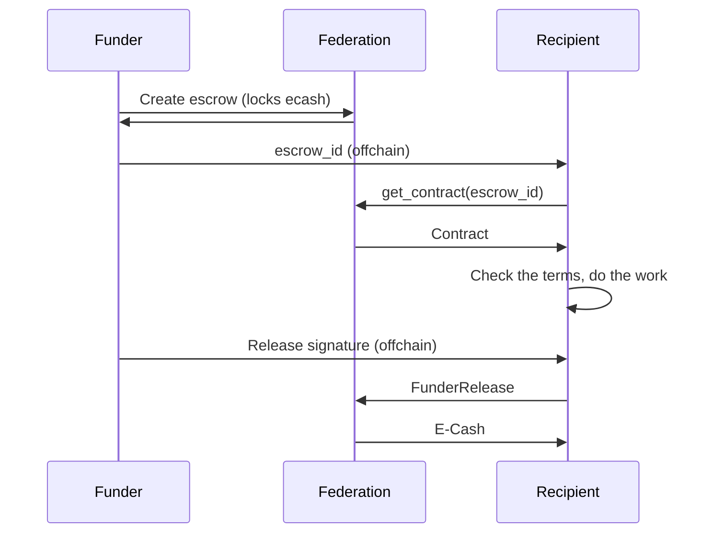
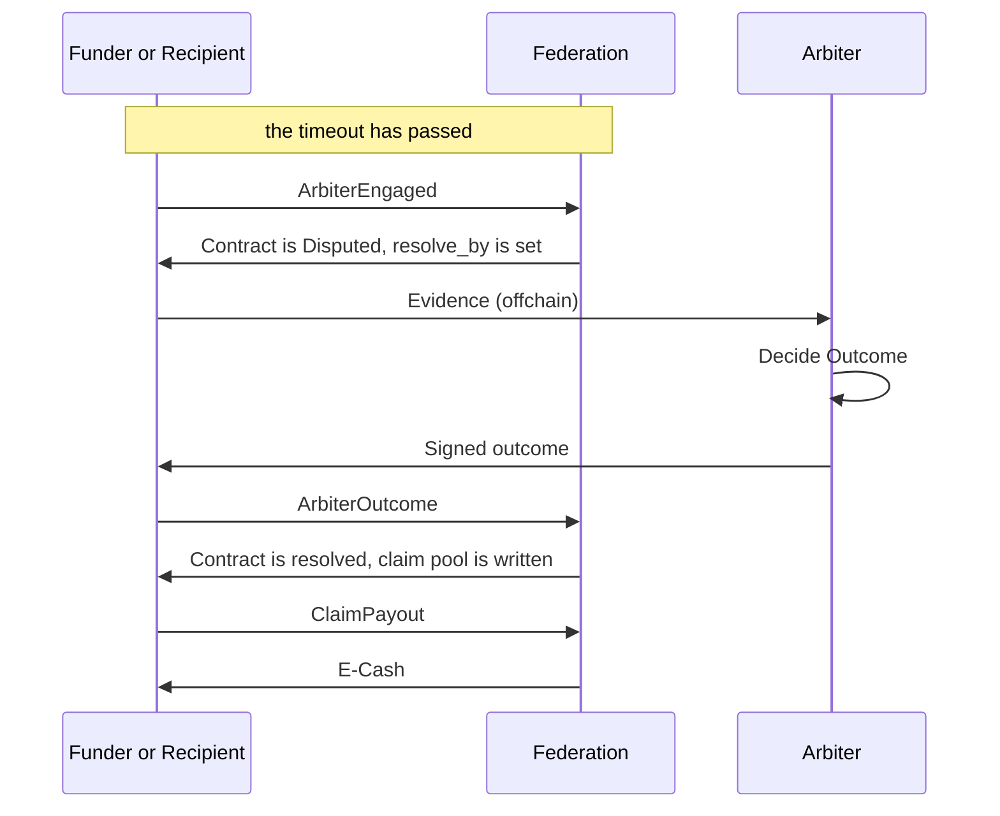
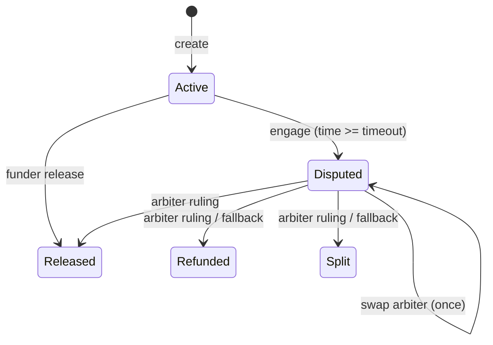
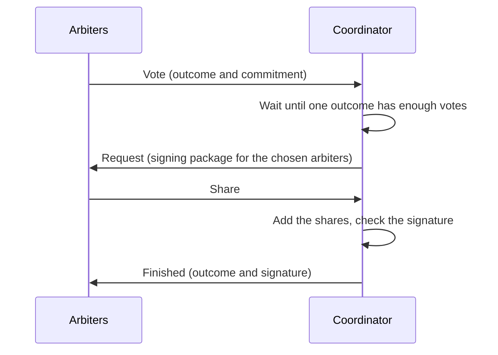

# Escrow Module
The escrow module lets two people trade with ecash when they don't trust each other. The funder locks ecash in a contract, the recipient does their part, and the funder signs a release so the recipient can claim the ecash. If they disagree, an arbiter decides. The federation only enforces the contract rules and verify signatures. It doesn't know who the people are and it can't see what the deal is about.

The module can't know if goods were delivered or a service was done. It only enforces what the contract and the signatures say.

### Roles
- Funder - locks the ecash and signs the release when they are happy.
- Recipient - gets the ecash. Does their part of the deal outside of the federation.
- Arbiter - decides when the two disagree. It can be one key or a group of arbiters, the federation sees one public key either way (see [Arbiter consortium](#arbiter-consortium)).
- Fee keys - the keys that share the arbiter fee.

### The contract
`EscrowContract` is created by the funder and stored by the federation under its `escrow_id`.

- `escrow_id` - `sha256("escrow_id" || contract_hash || random nonce)`.
- `funder_key`, `recipient_key`, `arbiter_key` - schnorr public keys. They are compared by their x-only form, because that is all a schnorr signature uses.
- `arbiter_fee_key` - list of keys that share the arbiter fee, at most 32.
- `amount` - the locked amount.
- `arbiter_fee` - the part of `amount` that goes to the fee keys if the arbiter rules.
- `timeout` - unix time. Before it only the funder's release works, after it a party can bring in the arbiter.
- `resolution_period` - seconds the arbiter has to rule after it was brought in. At least 10 minutes.
- `default_fallback` - what happens if the arbiter is silent: `Refund`, `Split { funder_split_bps, recipient_split_bps }` or `SwapArbiter { arbiter_key, arbiter_fee_key, arbiter_fee }`.
- `federation_id` and `contract_hash`.
- `status` - `Active`, `Disputed { resolve_by, swapped }`, `Released`, `Refunded` or `Split`.

[compute_contract_hash](../modules/fedimint-escrow-common/src/lib.rs) hashes funder, recipient, arbiter, arbiter fee, amount, timeout, federation id, resolution period, fee keys and the default fallback. It does not cover `status` or `escrow_id`.

Splits are in basis points (parts per 10,000) and both sides have to add up to 10,000.

### Federation time
Timeouts need a clock that every guardian agrees on. Each guardian votes with its own clock, rounded down to a full minute (`EscrowConsensusItem::UnixTimeVote`). A vote can only go up. The time the module uses is the highest time that a threshold of guardians has reached. It is 0 until the first votes are in.

- [Escrow::consensus_unix_time](../modules/fedimint-escrow-server/src/lib.rs) - computes the federation time from the votes.

This means time moves in steps of one minute and a timeout is never exact. Clients read the time with the `consensus_unix_time` endpoint, so the checks a client does before it submits can be a bit off. The federation always decides with its own time.

### Creating an escrow - User Client
- [EscrowClientModule::create_escrow](../modules/fedimint-escrow-client/src/lib.rs) - sets the `timeout` to the federation time plus the requested duration, computes the contract hash, picks a `escrow_id`, validates the contract and submits a transaction with the contract as an output. The output takes `amount` from the funder's ecash.
- The funder gives the `escrow_id` to the recipient outside of the federation. The recipient can fetch the contract and check that everything matches the deal (keys, amount, arbiter, timeout and fallback) before they do any work.

### Creating an escrow - Federation
- [Escrow::process_output](../modules/fedimint-escrow-server/src/lib.rs) - validates the contract with [validate_contract_fields](../modules/fedimint-escrow-common/src/lib.rs), recomputes the contract hash, rejects an `escrow_id` that already exists and stores the contract.

A contract is rejected if:
- the amount is zero or the arbiter fee is not smaller than the amount
- the timeout is not in the future, or the resolution period is shorter than 10 minutes
- a split doesn't add up to 10,000
- funder, recipient, arbiter and fee keys are not all different from each other (also counting the keys in `SwapArbiter`)
- there is a fee but no fee key, or more than 32 fee keys
- timeout plus two resolution periods must fit in 64 bits

### Resolving
After creation everything is an `EscrowInput { escrow_id, resolution }`.

| Resolution | Works when | Result | Signs the tx |
|---|---|---|---|
| `FunderRelease` | contract is `Active`, the funder signed the Release message | `Released`, recipient gets the full amount in this same transaction | recipient |
| `ArbiterEngaged` | `Active`, time >= `timeout`, a party signed the engage message | `Disputed { resolve_by = now + resolution_period }` | the party |
| `ArbiterOutcome` | `Disputed`, time <= `resolve_by`, the current arbiter signed the outcome | `Released`, `Refunded` or `Split`, a claim pool is written | the submitter |
| `ResolveFallbackPolicy` | `Disputed`, time > `resolve_by`, claimer is a party | the arbiter is swapped (once) or the contract is `Refunded` / `Split`, a claim pool is written | the claimer |
| `ClaimPayout` | the claim pool has an entry for the key | the entry is paid and removed | the key in the pool |


- The funder release is not limited by time. It works before and after the timeout until someone brings in the arbiter. After that it is rejected, so a release signature that is still around can't beat the arbiter.
- Only the recipient can submit a release, because the transaction has to be signed with the recipient's key.
- An arbiter ruling can be submitted by any key of the contract: funder, recipient, arbiter, a fee key or the keys of the swap arbiter. The submitter only signs the transaction. What matters is the arbiter signature inside the input.
- At exactly `resolve_by` the arbiter can still rule and the fallback is not available yet.
- The `fallback` field in `ResolveFallbackPolicy` is not looked at by the federation. It always uses `default_fallback` from the contract.

### Releasing - the happy path


- [EscrowClientModule::resolve_escrow](../modules/fedimint-escrow-client/src/lib.rs) - the recipient submits the funder's release signature.
- [Escrow::handle_resolution](../modules/fedimint-escrow-server/src/lib.rs) - checks the release, marks the contract `Released` and returns the full `amount` as the input amount, which the client turns into ecash. No arbiter fee is taken, the arbiter did no work.

### Disputes


- [EscrowClientModule::engage_arbiter](../modules/fedimint-escrow-client/src/lib.rs) - a party signs the engage message and submits it. No funds move.
- [EscrowClientModule::submit_arbiter_decision](../modules/fedimint-escrow-client/src/lib.rs) - submits the signed outcome of the arbiter. The client picks one of its own keys that is in the contract to sign the transaction.
- [EscrowClientModule::trigger_fallback](../modules/fedimint-escrow-client/src/lib.rs) - a party asks for the fallback after `resolve_by`.

If the arbiter stays silent past `resolve_by`, its signature is not accepted anymore and a party can trigger the fallback. `Refund` and `Split` resolve the contract with no arbiter fee, since nobody did any work.

With `SwapArbiter` the first trigger doesn't pay anyone. It sets `swapped: true` and a new `resolve_by`. From then on the swap arbiter key, fee keys and fee are the active ones, and a ruling signed by the old arbiter fails with `InvalidSignature`. If the new arbiter is silent too, the next trigger refunds. A second swap is not possible.

### Claim pool
A ruling or a fallback doesn't pay anyone in the same transaction. It writes a claim pool for the `escrow_id`, a list of `(key, amount)` entries:
- `Release` - the recipient gets `amount - arbiter_fee`.
- `Refund` - the funder gets `amount - arbiter_fee`.
- `Split` - the funder and the recipient split `amount - arbiter_fee`. The funder share is rounded down in msats and the recipient gets the rest.
- The fee is split equally between the fee keys.
- A fallback has no fee, the whole amount goes to the parties.

The entries always add up to `amount` and entries with zero are dropped. Every key claims its own entry with `ClaimPayout`, in any order, and when the last entry is gone the pool is deleted. A funder release is the only case that pays directly and has no pool.

- [EscrowClientModule::claim_payout](../modules/fedimint-escrow-client/src/lib.rs) - claims the entry of the first client key that is in the pool.
- [Escrow::handle_claim](../modules/fedimint-escrow-server/src/lib.rs) - removes the entry (keys are compared x-only) and returns its amount.
- [Escrow::audit](../modules/fedimint-escrow-server/src/lib.rs) - an `Active` or `Disputed` contract counts its `amount` as a liability. A resolved contract counts nothing, the pool counts whatever is not claimed yet.

### States


`Released`, `Refunded` and `Split` are final. The money in them is only paid once the claim pool is claimed, except for the funder release.

### All rules in one place
The checks for a resolution (state, time, who is allowed, signatures) are in [check_resolution](../modules/fedimint-escrow-common/src/rules.rs). It is a pure function: it gets the contract, the resolution and the time, and it returns an `AcceptedResolution` with three things:
- `transition` - the `EscrowTransition` to apply
- `settlement` - nothing to pay, pay the recipient now, or write these claims
- `input_key` - the key that has to sign the transaction input

It never touches the database. The federation calls it in `handle_resolution` and then applies the transition with [EscrowContract::transition](../modules/fedimint-escrow-common/src/lib.rs), which is the only place that changes `status`. The client calls the same function before it submits, so a client can't disagree with the federation about the rules (it can still be wrong about the time). `ClaimPayout` is not part of this, it goes through `ClaimPool::take_claim`.

### Signed messages
Every signature is a schnorr signature over a sha256 digest, see [compute_escrow_message](../modules/fedimint-escrow-common/src/lib.rs):
- resolution message - `escrow_resolution_message`, federation id, escrow id, outcome, contract hash. The funder always signs it with the outcome `Release`. The arbiter signs it with the outcome it chose
- engage message - `arbiter_engaged`, escrow id, federation id, contract hash. Signed by the funder or recipient.

### Client keys
The client derives its keys from the module root secret:
- child 0, `escrow_key` - the key a user has as funder, recipient or disputant. It signs messages and transaction inputs.
- child 1, `arbiter_fee_key` - the key used to receive and claim arbiter fees. It can also submit rulings.
- child 3, iroh key - the identity used for the arbiter consortium network. Child 2 is not used.
- child 4, DkgStateKey - to encrypt and decrypt the client side dkg state and packages.

The public keys are available with the `get_client_escrow_pubkey` and `get_arbiter_fee_pubkey` client calls. [EscrowClientModule::list_contracts](../modules/fedimint-escrow-client/src/lib.rs) finds every contract that has one of the two keys in it.

### Arbiter consortium
The federation checks one signature against `arbiter_key`. That key can belong to a group of arbiters who made it together with FROST, then any `t` of the `n` arbiters can sign and nobody ever holds the whole private key. The federation can't tell the difference. The code is in [frost](../modules/fedimint-escrow-client/src/frost/).

A group has 4 to 32 arbiters and needs `n - f` of them to sign, where `f = (n - 1) / 3`:

| arbiters | needed to sign |
|---|---|
| 4 | 3 |
| 5 | 4 |
| 7 | 5 |
| 10 | 7 |

The funder puts the group key in the contract as `arbiter_key` and the fee key of every arbiter in `arbiter_fee_key`. Each arbiter then claims its own share of the fee. Nobody holds the full private key of the arbiter_key, so the signed ruling is submitted by a party or by a fee key holder.

#### Setting up the key (DKG)
- [FrostDkgSessionRecord](../modules/fedimint-escrow-client/src/frost/session.rs) - the group and the saved progress of the DKG. The `session_id` is a hash of the federation id and the sorted arbiter ids, so every arbiter gets the same one. An arbiter id (`FrostParticipant`) is derived from its `escrow_key`.
- [DkgRunner](../modules/fedimint-escrow-client/src/frost/dkg.rs) - the DKG steps and the messages to the other arbiters.
- [FrostDkgSessionRecord::run](../modules/fedimint-escrow-client/src/frost/session.rs) - runs the DKG from the last saved step:

```
Created -> Round1Started -> Round1Complete -> Round2Complete -> Confirming -> Finalized
```

1. Every arbiter makes a secret polynomial and sends the public part to everyone (round 1).
2. Every arbiter sends a secret share to each other arbiter, one by one (round 2).
3. Every arbiter checks the shares it got and computes its key share and the group key.
4. `Confirming`: the arbiters send each other a digest of the group key and all verifying shares. The key is only final when everybody has the same digest, otherwise the DKG is dropped. This stops one arbiter from giving different arbiters different keys.

Every step is saved in the client database, so a restart continues where it was. A step that failed because of the network is tried again up to 3 times. Anything else (bad data, wrong session) throws the saved progress away. [FrostDkgSessionRecord::reset](../modules/fedimint-escrow-client/src/frost/session.rs) clears an unfinished DKG but refuses to touch a finished key.

[consortium_pubkey](../modules/fedimint-escrow-client/src/frost/session.rs) turns the result into the public key that goes into the contract.

#### Signing a ruling
[frost_sign.rs](../modules/fedimint-escrow-client/src/frost/frost_sign.rs) does the signing. Every arbiter works out the message itself from the contract, so a coordinator can't ask for a signature on something else.



- [SigningMux](../modules/fedimint-escrow-client/src/frost/frost_sign.rs) - the only reader of the transport. It sorts incoming messages by escrow and drops messages from non-members, oversized ones and ones that can't be parsed.
- [sign_as_signer](../modules/fedimint-escrow-client/src/frost/frost_sign.rs) - votes, and signs only if the coordinator asks for exactly the message of the outcome it voted for.
- [sign_as_coordinator](../modules/fedimint-escrow-client/src/frost/frost_sign.rs) - takes the outcome that got enough votes, asks those arbiters to sign and adds the shares. Before it announces anything it checks the result as a normal BIP340 signature against the group key, which is what the federation will do.
- [sign_with_failover](../modules/fedimint-escrow-client/src/frost/frost_sign.rs) - every arbiter calls this with the outcome it chose. Time is cut into slots and the coordinator of a slot comes from the escrow id and the slot number, so everybody agrees on it without talking. If a slot fails (for example the coordinator is offline) the next slot has another coordinator. It must finish before the contract's `resolve_by`.

The arbiters have to finish in time. If no ruling reaches the federation before `resolve_by`, the fallback decides.

#### Transport
The arbiters talk through a transport ([transport](../modules/fedimint-escrow-client/src/frost/transport/)). It has two parts, one for the DKG rounds and one for the signing messages.
- Iroh - the real one. Arbiters connect to each other with iroh, a connection is tied to the iroh node id of the arbiter, and every message carries the session id. Messages from unknown nodes or other sessions are dropped.
- File - writes files in a temp directory. For testing purpose only.

### API
The server has four public endpoints. They are listed in [api.md](./api.md#escrow-module-api-endpoints).
- `get_contract` - a contract by `escrow_id`
- `get_claim_amount` - the claim pool of an escrow
- `list_contract_by_key` - the contracts that have a key in them
- `consensus_unix_time` - the federation time
